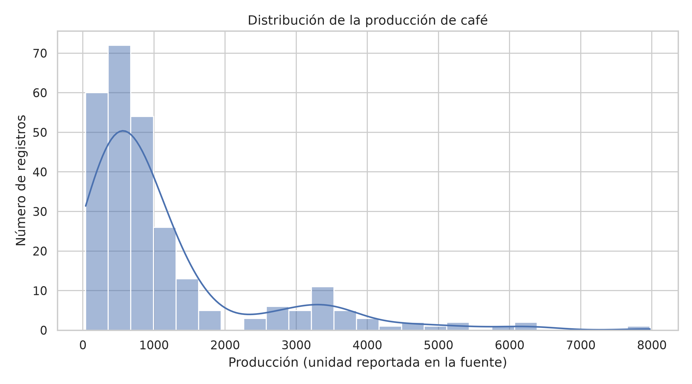
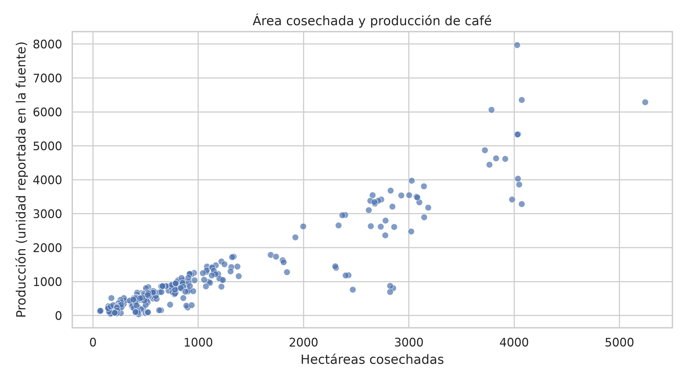
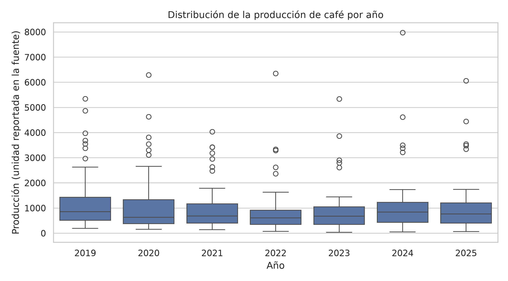
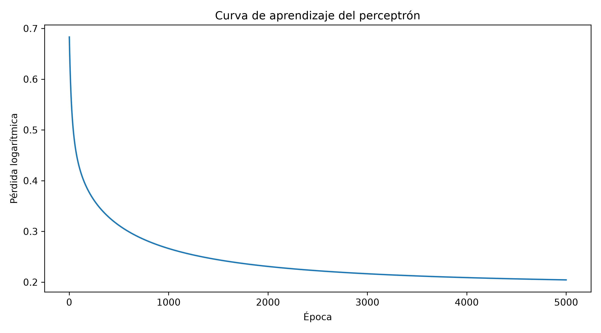
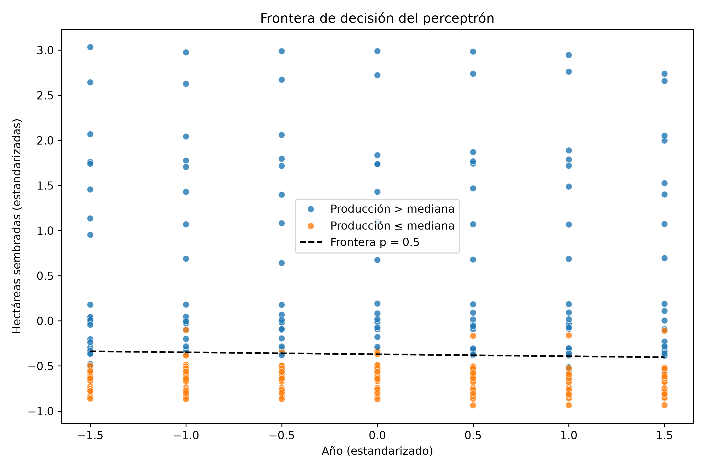
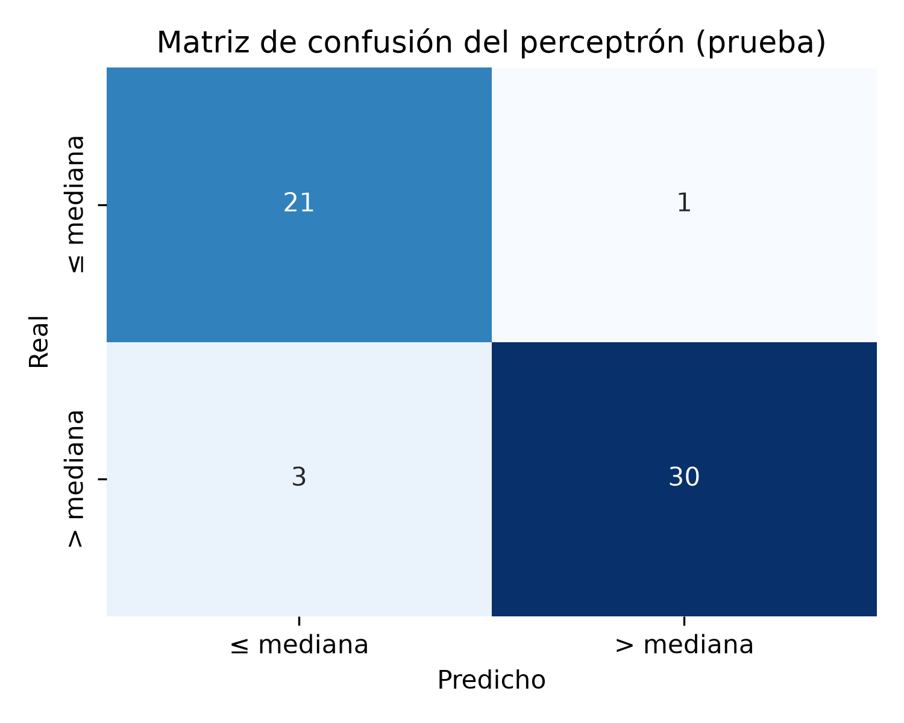
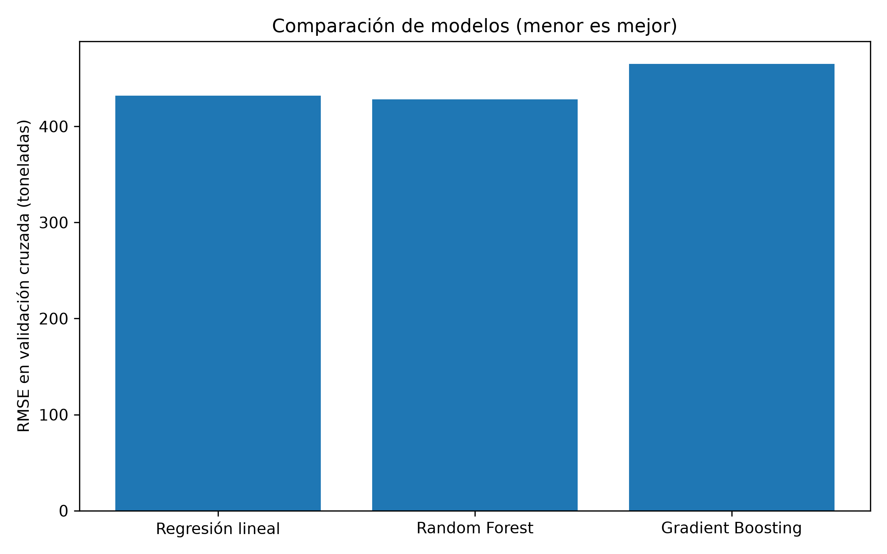
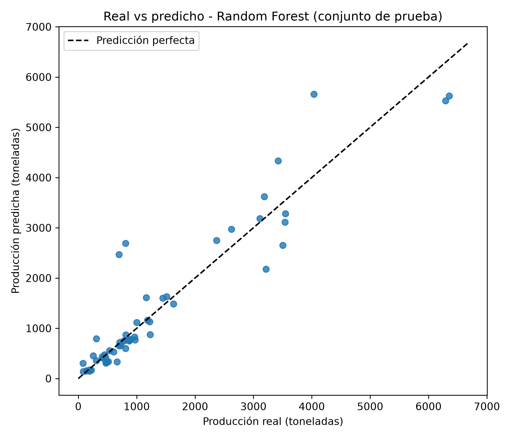

# Predicción de la producción de café en Cartago, Valle del Cauca
 
**Proyecto final de Inteligencia Artificial** · Ingeniería de Sistemas · Corporación de Estudios Tecnológicos del Norte del Valle · Período 2026-02
**Docente:** Jhon James Cano Sánchez
 
| | |
|---|---|
| **Integrantes** | MONICA ALEJANDRA PARRA QUINTERO |
| **Informe final** |  |
| **Repositorio** | https://github.com/monialeja1011/Prediccion-Cafetera---Monica-Alejandra-Parra.git |
| **Sustentación** | Lunes 23 de noviembre de 2026 |
 
---
 
## Tabla de contenido
 
1. [Resumen](#1-resumen)
2. [Problemática y objetivos](#2-problemática-y-objetivos)
3. [Datos](#3-datos)
4. [Análisis exploratorio](#4-análisis-exploratorio)
5. [Metodología](#5-metodología)
6. [Resultados](#6-resultados)
7. [Demostración: usar el modelo guardado](#7-demostración-usar-el-modelo-guardado)
8. [Estructura del repositorio](#8-estructura-del-repositorio)
9. [Cómo ejecutar el proyecto](#9-cómo-ejecutar-el-proyecto)
10. [Reproducibilidad y control de fuga de información](#10-reproducibilidad-y-control-de-fuga-de-información)
11. [Limitaciones y consideraciones éticas](#11-limitaciones-y-consideraciones-éticas)
12. [Trabajo futuro](#12-trabajo-futuro)
13. [Tecnologías](#13-tecnologías)

---
 
## 1. Resumen
 
Este proyecto construye un sistema de inteligencia artificial que **estima la producción anual de café (en toneladas)** de los municipios del Valle del Cauca, con énfasis en Cartago, a partir del año y de las hectáreas sembradas y cosechadas.
 
El sistema recorre el ciclo completo: datos → preparación → modelo construido desde cero → modelos de Scikit-Learn → evaluación → demostración. Incluye:
 
- Un **perceptrón con sigmoide implementado desde cero con NumPy**, que clasifica si la producción de un registro supera la mediana, y cuyos pesos se interpretan.
- La **comparación de tres modelos de regresión de Scikit-Learn** (regresión lineal, Random Forest y Gradient Boosting) con `Pipeline`, división entrenamiento/prueba y validación cruzada.
- Una **revisión de fuga de información** con validación cruzada agrupada por municipio, que muestra cuánto empeora el modelo ante municipios que nunca ha visto.
- Un **entorno reproducible con Docker** y una demostración (`usar_modelo.py`) que carga el modelo guardado sin reentrenar.
**Resultado principal:** el Random Forest estima la producción con un error absoluto medio de unas 300 toneladas y un R² de 0,87 en el conjunto de prueba. Sin embargo, cuando se evalúa con municipios completamente nuevos, su R² baja a 0,58, por lo que el modelo es más confiable para municipios que ya aparecen en los datos.
 
---
 
## 2. Problemática y objetivos
 
### Problemática
 
La producción cafetera varía entre municipios y entre años. Contar con una estimación basada en datos históricos ayuda a anticipar volúmenes y a apoyar la planeación de quienes trabajan con el café. Cartago, en el norte del Valle, tiene una superficie cafetera pequeña frente a los municipios líderes del departamento, y su producción registrada cambia de un año a otro (entre 80 y 396 toneladas en 2019–2025), lo que hace útil una herramienta de estimación.
 
> La estimación es una salida del modelo, calculada a partir de datos históricos y de las entradas suministradas. **No es una medición oficial ni garantiza la producción futura.**
 
### Objetivo general
 
Desarrollar un sistema de inteligencia artificial que estime la producción de café del Valle del Cauca a partir de variables agrícolas, y que sea reproducible y explicable.
 
### Objetivos específicos
 
1. **Preparar** los datos oficiales de evaluaciones agropecuarias, documentando su calidad y las decisiones de limpieza.
2. **Implementar** un perceptrón desde cero con NumPy e **interpretar** sus pesos y su frontera de decisión.
3. **Comparar** al menos dos modelos de Scikit-Learn con `Pipeline`, validación cruzada y métricas adecuadas, y **justificar** el modelo elegido.
4. **Construir** una demostración que cargue el modelo guardado y estime casos nuevos, dentro de un entorno reproducible con Docker.
---
 
## 3. Datos
 
### Fuente
 
Los datos provienen de las **Evaluaciones Agropecuarias Municipales (EVA)**, publicadas por el Ministerio de Agricultura y Desarrollo Rural de Colombia y disponibles en el portal de datos abiertos. El archivo usado está en `data/eva_base_agricola.csv` (≈ 33 MB).
 
- **Archivo utilizado:** `data/eva_base_agricola.csv` (aproximadamente 33 MB).
- **Recurso de descarga:** [Cultivos permanentes — Datos Abiertos del Valle del Cauca](https://datosabiertos.valledelcauca.gov.co/dataset/55a3d384-fec1-4267-8541-7d62a3fc9223/resource/7c578f9f-094d-4e6e-b1db-2f5e3bde32c9/download/cultivos_permanentes.csv)
- **Portal de consulta:** [Evaluaciones Agropecuarias Municipales (EVA) — datos.gov.co](https://www.datos.gov.co/Agricultura-y-Desarrollo-Rural/Evaluaciones-Agropecuarias-Municipales-EVA/2pnw-mmge/data)

### Calidad de los datos y limpieza
 
`src/limpiar_datos.py` filtra los registros de **café del Valle del Cauca** y genera `data/cafe_valle_limpio.csv`. El script imprime cada revisión que realiza:
 
| Revisión | Resultado |
|---|---|
| Base original | 166.732 filas × 18 columnas |
| Valores nulos | 0 (en la base completa y en el café del Valle) |
| Filas duplicadas | 0 |
| Valores negativos en las medidas | 0 |
| Área cosechada mayor que la sembrada | 0 |
| Registros finales (café, Valle del Cauca) | **273 registros, 39 municipios, años 2019–2025** |
 
**Valores atípicos.** El criterio IQR señaló valores extremos en las cuatro medidas: área sembrada (47), área cosechada (46), producción (40) y rendimiento (27). **Se conservaron**, porque ser estadísticamente extremo no prueba que sea un error: son en su mayoría municipios grandes, y las comprobaciones de consistencia no encontraron valores imposibles. Eliminarlos habría quitado información real.
 
**Trazabilidad.** El script guarda el resumen antes/después en `data/resumen_antes_despues.csv`. La reducción de filas y columnas corresponde únicamente al filtro de alcance (café del Valle y variables seleccionadas); el tratamiento posterior no eliminó ninguno de los 273 registros.
 
### Diccionario de variables (`cafe_valle_limpio.csv`)
 
| Variable | Descripción | Unidad |
|---|---|---|
| `codigo_municipio` | Código DANE del municipio (Cartago = 76147) | — |
| `municipio` | Nombre del municipio | — |
| `año` | Año de la evaluación (2019–2025) | año |
| `hectareas_sembradas` | Área sembrada con café | hectáreas |
| `hectareas_cosechadas` | Área cosechada | hectáreas |
| `produccion` | Producción de café | toneladas |
| `rendimiento` | Producción por hectárea cosechada | t/ha |
 
### Estadísticas descriptivas
 
| Variable | Media | Mediana | Máximo |
|---|---:|---:|---:|
| Hectáreas sembradas | 1.313,8 | 808,0 | 5.320 |
| Hectáreas cosechadas | 1.079,5 | 647,0 | 5.243 |
| Producción (t) | 1.143,6 | 688,7 | 7.972,98 |
| Rendimiento (t/ha) | 1,06 | 1,12 | 2,96 |
 
La media de producción (1.143,6 t) es bastante mayor que la mediana (688,7 t): la distribución tiene una cola hacia municipios muy productivos.
 
---
 
## 4. Análisis exploratorio
 
`src/graficos_seaborn.py` genera tres gráficos en `data/`.
 
### Figura 1. Distribución de la producción

 
La mayor parte de los registros se concentra en producciones bajas y la distribución tiene una cola hacia valores altos. Esos valores extremos se conservaron porque no se identificaron como errores.
 
### Figura 2. Área cosechada y producción

 
Existe una relación positiva clara: a mayor área cosechada, mayor producción (la correlación entre área sembrada y producción es de 0,93). La dispersión entre áreas similares muestra que el área **no explica por sí sola** toda la variación.
 
### Figura 3. Producción por año

 
Las medianas fluctúan entre años y hay observaciones altas en todos los períodos, **sin una tendencia anual sostenida**. El año aporta poca información por sí solo.
 
---
 
## 5. Metodología
 
### 5.1 Perceptrón desde cero (`src/perceptron_proyecto.py`)
 
Una sola neurona implementada con NumPy: combinación lineal de las entradas, función sigmoide, pérdida logarítmica y descenso del gradiente.
 
**Tarea.** Clasificación binaria: `1` si la producción supera la mediana del conjunto de entrenamiento (671,91 t) y `0` en caso contrario.
 
**Entradas.** `año` y `hectareas_sembradas`. No se usa `produccion` (define la etiqueta) ni `rendimiento` (se calcula con la producción).
 
**Procedimiento.**
 
1. División 80 % entrenamiento (218 registros) / 20 % prueba (55 registros), con semilla fija.
2. Cálculo de la mediana y de la media y desviación **solo con entrenamiento**.
3. Estandarización: `(valor − media) / desviación`. Sin ella, las hectáreas (miles) dominarían al año (≈ 2.020).
4. Entrenamiento: 5.000 épocas, tasa de aprendizaje 0,1. En cada época se calculan las probabilidades `p = σ(X·w + b)`, el error `p − y` y se actualizan los pesos con el gradiente.
5. Evaluación en entrenamiento y en prueba, con matriz de confusión.
6. Los pesos, la media, la desviación y el umbral se guardan en `src/perceptron_pesos.npz` para usarlos en la demostración.
### 5.2 Modelos de Scikit-Learn (`src/modelo_proyecto.py`)
 
**Tarea.** Regresión: estimar `produccion` (toneladas) a partir de `año`, `hectareas_sembradas` y `hectareas_cosechadas`.
 
| Modelo | Idea |
|---|---|
| Regresión lineal | Ajusta el mejor plano que atraviesa los datos. Es el modelo de referencia, simple y fácil de interpretar. |
| Random Forest | Muchos árboles de decisión entrenados con muestras distintas; su predicción es el promedio. |
| Gradient Boosting | Árboles en secuencia: cada uno corrige los errores del anterior. |
 
**Pipeline.** Cada modelo va dentro de un `Pipeline` (`StandardScaler` + modelo). Así, en cada pliegue de la validación cruzada el escalador se ajusta solo con los datos de entrenamiento de ese pliegue.
 
**Evaluación.**
 
1. División 80/20 (`random_state=42`).
2. Validación cruzada de 5 pliegues sobre el conjunto de entrenamiento.
3. El mejor modelo se elige por el **RMSE de la validación cruzada**, no por el conjunto de prueba, que se usa una sola vez al final.
4. Revisión adicional con `GroupKFold` por municipio (ver sección 10).
5. El Pipeline ganador se guarda con `joblib` en `src/modelo_final.joblib`.
**Métricas.**
 
| Métrica | Qué mide | Por qué se usa |
|---|---|---|
| MAE | Error promedio, en toneladas | Es la más fácil de explicar: "el modelo se equivoca en promedio X toneladas". |
| RMSE | Como el MAE, pero castiga más los errores grandes | Importa cuando un error grande (por ejemplo en un municipio grande) es más grave que varios pequeños. |
| R² | Proporción de la variación que explica el modelo | Permite comparar modelos en una escala de 0 a 1. |
 
---
 
## 6. Resultados
 
### 6.1 Perceptrón
 
| Resultado | Valor |
|---|---:|
| Umbral (mediana en entrenamiento) | 671,91 t |
| w₁ (año, estandarizado) | 0,0573 |
| w₂ (hectáreas sembradas, estandarizadas) | 8,7544 |
| Sesgo (b) | 3,1791 |
| Pérdida inicial → final | 0,6931 → 0,2214 |
| Exactitud en entrenamiento | 93,12 % |
| Exactitud en prueba | **92,73 %** |
 
**Matriz de confusión en prueba** (filas = real, columnas = predicho):
 
| | Predicho ≤ mediana | Predicho > mediana |
|---|---:|---:|
| **Real ≤ mediana** | 21 | 1 |
| **Real > mediana** | 3 | 30 |
 



 
**Interpretación de los pesos.**
 
- Ambos pesos son **positivos**: más año o más hectáreas sembradas aumentan la probabilidad de superar la mediana.
- Como las entradas están estandarizadas, los pesos son comparables: **w₂ (8,75) es unas 150 veces mayor que w₁ (0,057)**. El área sembrada es lo que domina la decisión; el año casi no aporta, lo que coincide con el análisis exploratorio (Figura 3).
- Llevada a unidades reales, la frontera de decisión equivale a **unas 800 hectáreas sembradas** (≈ 816 en 2019 y ≈ 791 en 2025): por encima de ese tamaño, el perceptrón predice que la producción supera la mediana.
- La curva de aprendizaje muestra que la pérdida baja de forma sostenida durante el entrenamiento.
- Hay puntos de ambas clases cerca de la frontera: los datos no son perfectamente separables con una línea recta, y por eso el modelo comete algunos errores (4 de 55 en prueba).
### 6.2 Modelos de Scikit-Learn
 
Valores en toneladas. CV = promedio de la validación cruzada de 5 pliegues sobre entrenamiento.
 
| Modelo | MAE (CV) | RMSE (CV) | R² (CV) | MAE (prueba) | RMSE (prueba) | R² (prueba) |
|---|---:|---:|---:|---:|---:|---:|
| Regresión lineal | 243,3 | 431,9 | 0,848 | 360,3 | 725,0 | 0,746 |
| **Random Forest** | **232,7** | **428,3** | 0,860 | 300,2 | 520,5 | 0,869 |
| Gradient Boosting | 246,4 | 465,2 | 0,833 | 277,6 | 487,7 | 0,885 |
 
**Modelo elegido: Random Forest**, por tener el menor RMSE en validación cruzada. En el conjunto de prueba obtiene MAE = 300,17 t, RMSE = 520,50 t y R² = 0,8689.
 
Gradient Boosting rinde ligeramente mejor en el conjunto de prueba, pero esa diferencia proviene de una sola división de 55 registros. La validación cruzada, que usa muchas divisiones, es una base de decisión más estable.
 


 
### 6.3 Validación cruzada agrupada por municipio
 
| Modelo | MAE | RMSE | R² |
|---|---:|---:|---:|
| Regresión lineal | 261,7 | 456,3 | 0,728 |
| Random Forest | 388,8 | 695,1 | 0,579 |
| Gradient Boosting | 396,2 | 720,0 | 0,545 |
 
Cuando cada municipio queda completo en un solo lado de la división (es decir, el modelo se prueba con municipios que nunca vio), el R² del Random Forest baja de 0,87 a 0,58, y la regresión lineal pasa a ser el modelo más estable. Ver la explicación en la sección 10.
 
---
 
## 7. Demostración: usar el modelo guardado
 
`src/usar_modelo.py` carga `src/modelo_final.joblib` y `src/perceptron_pesos.npz` **sin reentrenar** y estima casos nuevos.
 
```bash
python src/usar_modelo.py                    # casos de demostración
python src/usar_modelo.py 2026 280 240       # caso propio: año, sembradas, cosechadas
```
 
Salida para el escenario de demostración de Cartago:
 
```text
Cartago, escenario de demostración
  Año: 2026 | sembradas: 280 ha | cosechadas: 240 ha
  Producción estimada: 327.4 toneladas
  Perceptrón: probabilidad de superar 672 t (mediana) = 3.1%
  Aviso: el modelo se entrenó con años 2019-2025; un año fuera de ese rango es una extrapolación poco fiable.
```
 
**Cómo interpretarla.**
 
- El Random Forest estima **327,4 toneladas**, un valor dentro del rango histórico de Cartago (entre 242 y 396 t en 2019–2025, sin contar 2023, año atípico con solo 80 t).
- El perceptrón da una probabilidad de **3,1 %** de superar la mediana (672 t). Es coherente con la estimación: 327 t está muy por debajo de la mediana.
- El **aviso de extrapolación** aparece porque 2026 está fuera de los años de entrenamiento; los modelos de árboles no extrapolan, por lo que el resultado es un escenario ilustrativo y no un pronóstico.
- El script rechaza casos inválidos (área cosechada mayor que la sembrada).
---
 
## 8. Estructura del repositorio
 
```text
prediccion-cafetera/
├── Dockerfile
├── docker-compose.yml
├── requirements.txt
├── README.md
├── .dockerignore
├── .gitignore
├── data/
│   ├── eva_base_agricola.csv                  datos originales (EVA)
│   ├── cafe_valle_limpio.csv                  dataset limpio
│   ├── resumen_antes_despues.csv              resumen de la limpieza
│   ├── grafico_1_distribucion_produccion.png  análisis exploratorio
│   ├── grafico_2_area_produccion.png
│   ├── grafico_3_produccion_por_anio.png
│   ├── perceptron_curva_aprendizaje.png       evaluación del perceptrón
│   ├── perceptron_frontera_decision.png
│   ├── perceptron_matriz_confusion.png
│   ├── modelo_comparacion.png                 evaluación de modelos
│   └── modelo_real_vs_predicho.png
├── docs/

└── src/
    ├── limpiar_datos.py          preparación de datos (Pandas)
    ├── graficos_seaborn.py       gráficos de análisis (Seaborn)
    ├── perceptron_proyecto.py    perceptrón desde cero (NumPy)
    ├── modelo_proyecto.py        modelos de Scikit-Learn y guardado (joblib)
    ├── usar_modelo.py            demostración con el modelo guardado
    ├── modelo_final.joblib       mejor modelo guardado
    └── perceptron_pesos.npz      pesos del perceptrón
```
 
---
 
## 9. Cómo ejecutar el proyecto
 
### Requisitos
 
- [Docker](https://docs.docker.com/get-docker/) con Docker Compose.
- Git.
### Opción recomendada: Docker
 
**1. Clonar el repositorio**
 
```bash
git clone [COMPLETAR: URL del repositorio]
cd prediccion-cafetera
```
 
**2. Construir e iniciar el contenedor**
 
```bash
docker compose up -d --build
```
 
**3. Entrar al contenedor**
 
```bash
docker compose exec prediccion-cafetera bash
```
 
La terminal abre en `/app/src`. El proyecto está montado como volumen, así que los archivos generados quedan también en tu equipo.
 
**4. Ejecutar el flujo completo, en este orden**
 
```bash
python limpiar_datos.py         # genera data/cafe_valle_limpio.csv
python graficos_seaborn.py      # gráficos de análisis
python perceptron_proyecto.py   # perceptrón, pesos y 3 gráficos
python modelo_proyecto.py       # compara modelos y guarda modelo_final.joblib
python usar_modelo.py           # demostración (no reentrena)
```
 
**5. Apagar el contenedor**
 
```bash
exit
docker compose down
```
 
> El repositorio ya incluye `modelo_final.joblib` y `perceptron_pesos.npz`, por lo que `usar_modelo.py` funciona directamente, sin ejecutar los pasos anteriores.
 
### Verificación rápida
 
Si todo funciona, deberías ver estos valores:
 
| Script | Valor esperado |
|---|---|
| `limpiar_datos.py` | 273 registros, 39 municipios, años 2019–2025 |
| `perceptron_proyecto.py` | w₁ = 0,0573 · w₂ = 8,7544 · exactitud en prueba 0,9273 |
| `modelo_proyecto.py` | Mejor modelo: Random Forest · R² en prueba 0,8689 |
| `usar_modelo.py` | 327,4 toneladas para el escenario de Cartago |
 
### Alternativa: sin Docker (entorno virtual)
 
```bash
python3 -m venv .venv
source .venv/bin/activate          # En Windows: .venv\Scripts\activate
python -m pip install -r requirements.txt
 
python src/limpiar_datos.py
python src/graficos_seaborn.py
python src/perceptron_proyecto.py
python src/modelo_proyecto.py
python src/usar_modelo.py
```
 
Todos los scripts calculan sus rutas a partir de su propia ubicación, por lo que funcionan ejecutados desde cualquier carpeta.
 
---
 
## 10. Reproducibilidad y control de fuga de información
 
**Reproducibilidad.** Docker fija el entorno (Python 3.13 y las versiones de `requirements.txt`) y todos los procesos aleatorios usan semilla fija (42). Con los mismos datos, cada ejecución produce los mismos números.
 
**Medidas para que el modelo no "haga trampa":**
 
| Riesgo | Cómo se evita |
|---|---|
| Que el conjunto de prueba influya en el entrenamiento | La división se hace antes de calcular cualquier estadístico; la prueba solo se usa al final. |
| Escalado con datos de prueba | En el perceptrón, la media y la desviación se calculan solo con entrenamiento; en Scikit-Learn, el escalador está dentro del `Pipeline`, que lo ajusta por pliegue. |
| Umbral calculado con todos los datos | La mediana que define las clases del perceptrón se calcula solo con entrenamiento. |
| Variables que revelan la respuesta | No se usa `rendimiento` como entrada, porque se calcula como producción / área cosechada. |
| Elegir el modelo mirando la prueba | El modelo se elige con la validación cruzada. |
 
**Fuga por municipio.** Cada municipio aparece siete veces (una por año). Con una división aleatoria, el mismo municipio puede quedar a la vez en entrenamiento y en prueba, y como las hectáreas de un municipio cambian poco de un año a otro, es probable que los modelos de árboles lo "reconozcan" por sus valores de área. Por eso se agregó la validación cruzada agrupada (`GroupKFold`), que mantiene cada municipio completo en un solo lado.
 
El resultado es informativo: la ventaja del Random Forest sobre la regresión lineal **desaparece (e incluso se invierte) con municipios nuevos**. La conclusión práctica es que el modelo estima mejor para municipios que ya están en los datos que para zonas nuevas.
 
---
 
## 11. Limitaciones y consideraciones éticas
 
**Limitaciones.**
 
- **Pocos datos:** 273 registros y solo siete años. Esto limita lo que cualquier modelo puede aprender y hace que las métricas varíen según la división.
- **Pocas variables:** el modelo no incluye clima, altitud, variedad de café, precio ni prácticas de manejo, que influyen en la producción.
- **Año de Cartago atípico:** en 2023, Cartago registra 80 t (rendimiento 0,30 t/ha), muy por debajo de sus demás años. No se eliminó por no ser un valor imposible, pero afecta cualquier análisis puntual del municipio.
- **Extrapolación:** el modelo se entrenó con 2019–2025. Para años futuros, los modelos de árboles repiten lo aprendido y no capturan tendencias nuevas; por eso 2026 se presenta como escenario.
- **Municipios nuevos:** como muestra la sección 6.3, el desempeño baja cuando el municipio no estaba en los datos.
- **Calidad de la fuente:** las EVA son reportes oficiales y pueden contener errores o diferencias de metodología entre municipios y años.
**Consideraciones éticas.**
 
- Las estimaciones **no deben usarse como cifra oficial ni como única base para decisiones económicas** (por ejemplo, de crédito o de compra de cosecha).
- Un error de estimación puede afectar a pequeños productores si se usa sin contrastarlo con información local.
- Los datos son agregados por municipio y de acceso público; no contienen información personal.
---
 
## 12. Trabajo futuro
 
- Incorporar **datos climáticos** (por ejemplo, del IDEAM) y de precios.
- Ampliar la serie histórica con más años y otros departamentos cafeteros.
- Evaluar un modelo por **series de tiempo** que respete el orden cronológico.
- Optimizar hiperparámetros con `GridSearchCV` y comparar una red neuronal (`MLPRegressor`).
- Ofrecer una **interfaz sencilla** (por ejemplo con Streamlit) sobre `usar_modelo.py`.
---
 
## 13. Tecnologías
 
Python 3.13 · Pandas · NumPy · Matplotlib · Seaborn · Scikit-Learn · joblib · Docker · Git y GitHub. Las versiones exactas están en `requirements.txt`.
 
